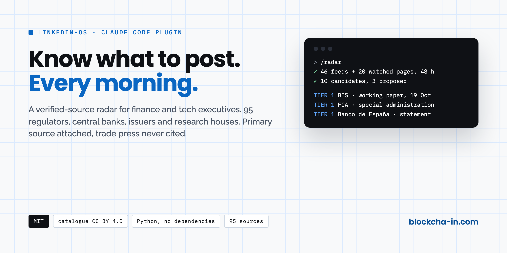
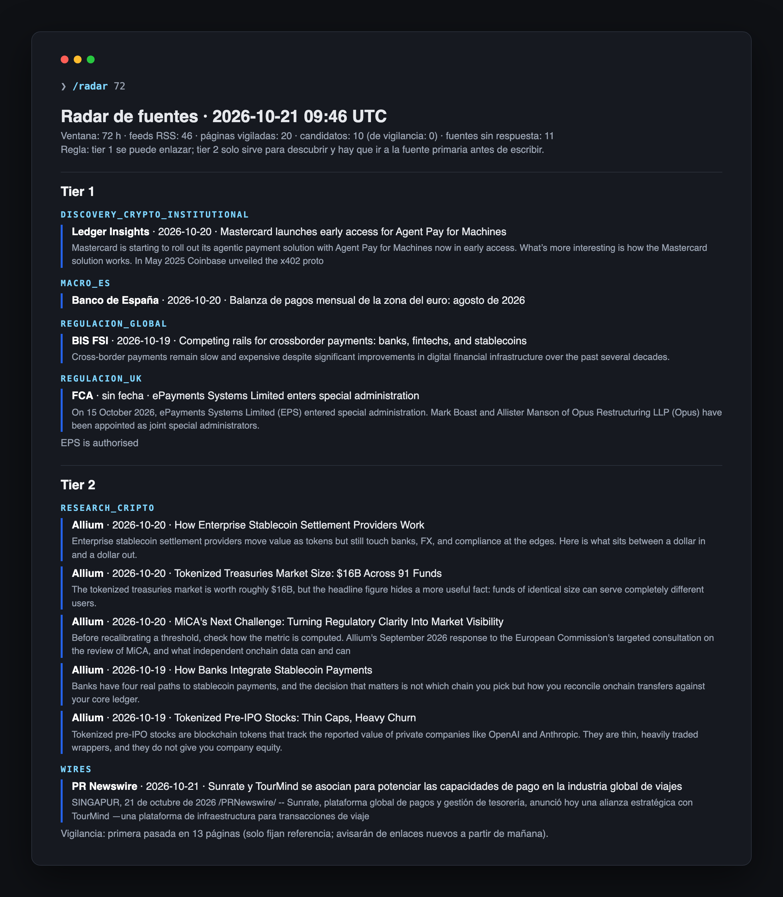

# linkedin-os



**You don't need to be first. You need to know what to post.** A verified-source radar for finance and tech executives, running inside Claude Code.

Every morning `/radar` reads what regulators, central banks, issuers and research firms have actually published in the last 48 hours, flags the new reports with a direct link to the PDF, filters everything by your topics, and hands you three angles with the primary source attached. No trade press, no aggregators, no "I saw this on LinkedIn".



## Install

Inside Claude Code, run these two commands:

```
/plugin marketplace add VRIBES-ETH/linkedin-os
/plugin install linkedin-os@linkedin-os
```

Restart Claude Code and run `/radar`. That is it. The scanner is plain Python 3 with no dependencies.

The first run uses example topics (tokenisation, stablecoins, MiCA, payments, custody). To use yours, copy `cliente/temas.example.json` to `~/.linkedin-os/temas.json` and edit the keyword lists, or just ask Claude to do it after the first `/radar`. Reports and state live in `~/.linkedin-os/`, so plugin updates never touch them.

The SEC only answers clients that identify themselves. To include its filings, set `export RADAR_USER_AGENT="Your Name you@domain.com"` before opening Claude Code.

Without Claude Code, the scanner runs on its own: `python3 scripts/radar.py` from a clone of this repository.

## Schedule on Publer

linkedin-os schedules on [Publer](https://publer.com/vribes), the scheduler I have used for years for my own profile and for every account I run.

- **Free to start.** The free plan connects up to 3 accounts (LinkedIn included) with 10 scheduled posts per account at a time. Enough to schedule by hand what `/radar` helps you write.
- **From Claude Code.** On the Business plan (from $10/month, 14-day trial), Publer's official MCP server lets Claude schedule straight into your LinkedIn queue, always with your explicit confirmation. Run `/publer` and it walks you through the connection.
- **Guarded.** The Publer API delete ignores ids and can wipe a whole queue. The `publer-guard` hook blocks any delete from Claude, whether it comes through the API or through an MCP.

[publer.com/vribes](https://publer.com/vribes) is my referral link: it supports this project and gives you 10 % off any paid plan. Already a user? Add `VRIBES` under Settings, "Referred by".

## What you get

| Piece | What it does |
| --- | --- |
| `/radar` | Scans both catalogues, writes `~/.linkedin-os/radar-YYYY-MM-DD.md` with new reports first, then proposes up to three angles with fact, primary source, why now, and a suggested format. Tier 2 items are never proposed until the primary source is located. |
| `fuentes/fuentes.json` | **95 verified sources** with tier, category, method and language: SEC, CFTC, OCC, ESMA, DG FISMA, FCA, PRA, FINMA, HKMA, CNMV, CVM, ECB, Fed, BoE, Banco de España, BIS, FSB, IMF, OMFIF, Tether, Circle, Coinbase Institutional, Fireblocks, Securitize, Glassnode, Messari, Galaxy, Kaiko, Coin Metrics, 21Shares, Pantera, a16z crypto, Allium, RWA.xyz, Chainalysis, TRM Labs, McKinsey, BCG, Citi Institute, JPMorgan Kinexys and more. Validated by hand between May and October 2026 for a daily digital-assets briefing. |
| `fuentes/research.json` | **32 report sources**: supervisors, think tanks, consultancies and research firms that publish reports: OECD, IOSCO, FATF, EBA, ESRB, WTO, AFME, BlackRock Investment Institute, ARK Invest, EY, KPMG, Deloitte, CoinShares, Anchorage Digital, Paxos, Ondo, Talos, GSR, Nansen, Dealroom, Wharton and more. The radar opens each new report and links the PDF directly when the page has one. |
| `scripts/radar.py` | Deterministic scanner. 51 RSS feeds plus 46 pages and sitemaps watched by link diff (a sitemap with dates reports from day one; a plain page starts reporting on day two). Dedupes against what you already saw. Lists the sources that block robots so you can search them by hand. |
| `hooks/` | Two guards that run before Claude writes or executes anything: a Spanish (Spain) copy lint that blocks em dashes, AI tells, missing accents and non-peninsular lexicon; and a Publer guard that blocks any delete, by API or MCP, because the Publer API delete ignores ids and wipes the whole queue. |
| `/publer` | Sets up Publer: free account, then the official MCP connection (Business plan) so Claude can schedule your posts with your confirmation. |
| `publer/GOTCHAS.md` | Sixteen hard-won rules about the Publer API, in Spanish. |

## The tier rule

Tier 1 is a regulator, central bank, institution, the company itself or a primary research house: you may link and quote it. Tier 2 is press, wires and aggregators: they exist to discover, never to cite. The radar prints the rule at the top of every run so it is impossible to forget.

## Adding a source

Check the feed responds with dated entries, decide the tier by the rule above (not by prestige), add it with `activo: true` and the date in `nota`. Pull requests that add or fix a source are welcome; see `fuentes/README.md` for the fields and `CONTRIBUTING.md` for the checks.

## Want the full editorial system?

The radar finds. It does not write. The complete system (voice kit built in a guided interview, writing layers with a 14-test anti-AI audit, infographic and carousel rendering, Publer scheduling with confirmation) is a paid install with a two-hour onboarding session. Details at [blockcha-in.com/linkedin-os](https://blockcha-in.com/linkedin-os).

## Licence

Code under MIT. The source catalogue `fuentes/fuentes.json` under CC BY 4.0: use it anywhere, credit Víctor Ribes.
